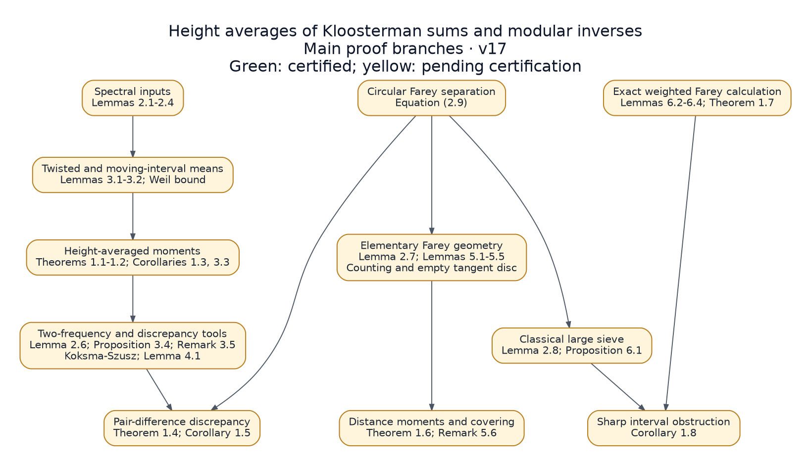

# Proof dependencies

This guide explains the dependency maps for **v17 of _Height averages of Kloosterman sums and modular inverses_**. The [inventory](INVENTORY.md) supplies the statements, source locators, supporting calculations, and exact literature references. The editable record is [`docs/dependency_inventory.json`](docs/dependency_inventory.json).

## Graph views

| View | Scope | Files |
| --- | --- | --- |
| Overview | 11 groups showing the main proof branches | [PDF](docs/dependency_overview.pdf) · [SVG](docs/dependency_overview.svg) · [PNG](docs/dependency_overview.png) · [DOT](docs/dependency_overview.dot) |
| Numbered statements | All 31 numbered results, both numbered remarks, and seven groups of trusted reference inputs | [PDF](docs/dependency_graph.pdf) · [SVG](docs/dependency_graph.svg) · [PNG](docs/dependency_graph.png) · [DOT](docs/dependency_graph.dot) |
| Complete documented dependencies | 92 nodes: 33 numbered entries, 46 supporting steps, and 13 literature inputs; 112 edges | [PDF](docs/dependency_complete.pdf) · [SVG](docs/dependency_complete.svg) · [DOT](docs/dependency_complete.dot) |

[](docs/dependency_overview.pdf)

The PDF and SVG versions are intended for enlargement. The complete graph is a large reference diagram; the overview is the more useful first view. Nodes in the numbered and complete SVG/PDF exports link to their inventory entries when opened in a viewer that supports links.

## Meaning of an arrow

An arrow points **from a prerequisite to a statement or calculation that uses it**. The record describes the written proof, not the order of exposition.

| Appearance | Meaning |
| --- | --- |
| Solid grey arrow | A mathematical input: an identity, estimate, statement, or supporting calculation |
| Dashed orange arrow | A trusted literature input at the locator recorded in the inventory |
| Dashed purple arrow | Reuse of a proof method, rather than use of that result's numerical conclusion |
| Blue or cyan box | A theorem, corollary, or proposition; the label specifies the kind |
| White box | A lemma |
| Dashed grey box | A numbered remark |
| Pale ellipse | A supporting calculation or elementary fact in the manuscript |
| Orange hexagon | A literature input |
| Orange box in the reference row | A group of trusted literature inputs from one reference work |

Colours do not indicate verification or formalization status. None of the entries is a Lean declaration.

**Literature convention:** cited literature results are treated as trusted inputs and are not reproved here. Their precise statements, hypotheses, parameter ranges, and normalizations must match each application. The reference row makes this scope explicit, as in the model repository.

### How the smaller views are obtained

The **numbered-statement graph** suppresses supporting nodes while retaining the paths they connect between numbered statements. It transitively reduces the solid arrows: if one numbered result reaches another through an intermediate numbered result, the additional direct arrow is removed from this view. A separate row groups the 13 literature inputs by their seven reference works. Its 14 source arrows stop at the first numbered result using each input, possibly through supporting calculations. The complete graph retains the individual literature locators and the actual recorded proof uses.

For example, the complete graph records the use of both the Kuznetsov formula in Lemma 2.1 and the window estimate in Lemma 2.2 in proving Lemma 3.1. Since Lemma 2.1 also feeds Lemma 2.2, the numbered graph keeps the path through Lemma 2.2 and suppresses the additional direct arrow. Its absence there does not mean the formula is unused.

The **overview** groups related statements and calculations. An arrow between groups means that part of the destination argument uses part of the source group; it does not assert that every item in one group uses every item in the other.

Every edge in the full JSON record has a reason. TeX labels identify numbered statements. The prefixes `step:`, `geom:`, `support:`, `external:`, and `ov:` identify repository records, not new manuscript statements.

## 1. Spectral inputs and height averages

[Lemma 2.1](INVENTORY.md#lem-kuznetsov) records the inverse Kuznetsov formula and the local spectral large sieve from BRS Lemma 4.3. [Lemma 2.2](INVENTORY.md#lem-window) derives the dual window bound from it. [Lemma 2.3](INVENTORY.md#lem-transforms) supplies the high and holomorphic transform estimates from BRS Lemma 4.2; [Lemma 2.4](INVENTORY.md#lem-low) proves the low-spectrum estimate using the cited Bessel integral representations.

These inputs feed [Lemma 3.1](INVENTORY.md#lem-twist), the twisted second moment. Mellin smoothing and Plancherel then combine this estimate with the Weil bound and an elementary moving-interval estimate to prove [Lemma 3.2](INVENTORY.md#lem-annulus).

Two consequences follow from Lemma 3.2:

- [Theorem 1.2](INVENTORY.md#thm-short) is its moving-interval formulation with signed frequencies.
- [Theorem 1.1](INVENTORY.md#thm-height) uses it directly with interval parameter $\delta=1$, followed by a dyadic decomposition of the cumulative sum.

The proof of Theorem 1.1 does not cite Theorem 1.2 as an intervening theorem. Its direct input is Lemma 3.2. From Theorem 1.1, Chebyshev gives [Corollary 1.3](INVENTORY.md#cor-most), and vector partial summation gives [Corollary 3.3](INVENTORY.md#cor-weighted).

Selberg's identity and the separate Ramanujan-sum bounds on the axes extend the height estimate to the frequency rectangle in [Proposition 3.4](INVENTORY.md#prop-two). [Remark 3.5](INVENTORY.md#rem-weighted-two) uses Proposition 3.4 as its numerical estimate and reuses the proof of Corollary 3.3. The latter relation is the dashed purple arrow.

## 2. Pair-difference discrepancy

[Lemma 4.1](INVENTORY.md#lem-pair-pointwise) applies the Koksma-Szusz inequality of [Lemma 2.9](INVENTORY.md#lem-ks) to the multiset of ordered differences. The relevant Fourier coefficients are squared absolute values. A separate identity controls the change on removing diagonal pairs.

The upper bound in [Theorem 1.4](INVENTORY.md#thm-pair-height) combines Lemma 4.1, Proposition 3.4, and the cardinality comparison $N_Y\asymp X^2$. Its lower bound has a different argument: first-coordinate injectivity and the elementary circular Farey separation estimate give an empty strip. [Corollary 1.5](INVENTORY.md#cor-pair-height-most) is then an exceptional-set consequence of the upper bound.

The graph therefore distinguishes the spectral upper-bound branch from the elementary lower-bound branch. The abstract classical large sieve of Lemma 2.8 is not used in either discrepancy argument.

## 3. Elementary distance moments

The proof of [Theorem 1.6](INVENTORY.md#thm-distance) uses no result from the spectral height or pair-discrepancy branches.

- **Upper bounds:** Farey adjacency gives [Lemma 5.1](INVENTORY.md#lem-farey-product), which constructs a point in each admissible product of Farey gaps. [Lemmas 5.2-5.3](INVENTORY.md#lem-adaptive) control adaptive Farey orders and their product. Together these give the distance tail in [Lemma 5.4](INVENTORY.md#lem-distance-tail), which is integrated to obtain the moment upper bounds. Farey products also give the covering upper bound used as a support cutoff.
- **Moment lower bounds:** elementary disc counting treats the subcritical range. [Lemma 5.5](INVENTORY.md#lem-empty) supplies empty squares for the supercritical bound and the critical packing argument. At the critical exponent, disjointness and a harmonic totient sum give the two logarithmic factors.
- **Covering lower bound:** an independent tangent-disc calculation gives this part of the theorem. It does not use Lemma 5.5.

The complete graph splits these parts before they enter Theorem 1.6. In particular, using the already proved covering upper bound during the moment proof creates no self-dependency of the theorem.

[Remark 5.6](INVENTORY.md#rem-negative) has three parts. Disc counting gives the negative-moment upper bound, Jensen uses only the positive first-moment upper estimate to give the lower bound, and a local integral at the origin proves divergence for $s\le-2$. The elementary upper bound for $N_X$ is sufficient here; the full summatory-totient asymptotic is not required.

## 4. Long-frequency ranges and the Farey correction

[Proposition 6.1](INVENTORY.md#prop-long) applies the abstract large sieve in [Lemma 2.8](INVENTORY.md#lem-sieve) to the reduced fractions in the trigonometric-polynomial expression for $A_Q(n,1)$. Circular separation gives the remainder $Q(Q-1)N_Q$.

The weighted calculation is a separate branch. [Lemma 6.2](INVENTORY.md#lem-poisson) gives the Poisson identity for the sinc-squared weight. In [Lemma 6.3](INVENTORY.md#lem-exact), compact support leaves only determinant-one pairs in the off-diagonal contribution. Their inverse phases give the exact correction. [Lemma 6.4](INVENTORY.md#lem-positive) proves positivity of the integral, and a uniform coprime lattice-sum calculation completes [Theorem 1.7](INVENTORY.md#thm-correction).

Theorem 1.7 does not require Proposition 6.1 or the large sieve. Those inputs first meet in [Corollary 1.8](INVENTORY.md#cor-obstruction): the positive weighted correction, the uniform interval bound, the weight normalization, and Abel summation with variation estimates force a sharp interval with a remainder of order $Q^4$. The sharp-interval conclusion is an absolute-value lower bound.

The fixed nonzero second argument in Section 7.4 is an unnumbered adaptation of these proofs, with constants depending on that argument. It is listed in the inventory's discussion section and is not counted as another theorem.

## Definitions, background, and literature boundaries

The graph records substantive proof steps. Routine definitions and ambient tools such as Cauchy-Schwarz, finite-sum rearrangements, the Chinese remainder theorem, Tonelli, Jensen, and elementary calculus are described in the associated records where useful. It is not an axiomatic graph of every background fact.

Two conventions prevent misleading cycles or dependencies:

- The integral $I(\tau)$ is defined in the statement of Theorem 1.7. Lemma 6.4 uses that definition, not the conclusion of Theorem 1.7; there is no backward proof edge from the theorem to the lemma.
- Circular separation, equation **(2.9)**, has a direct denominator-arithmetic proof. It is distinct from **Lemma 2.9**, the Koksma-Szusz inequality, and does not require the consecutive-Farey lemma merely because it is discussed nearby.

The [literature-input table](INVENTORY.md#literature-inputs) gives exact locators. Introductory comparisons and historical attribution are distinguished from premises. The companion paper and the earlier mean, distance, and Farey-correlation results are not made into proof dependencies simply because they motivate the present results.

## Regeneration and checks

Run from the repository root:

```bash
python3 scripts/build_dependency_graph.py --check
python3 scripts/build_dependency_graph.py
```

The first command checks identifiers, edge endpoints, duplicate edges, nonempty dependency reasons, statement counts, source-locator presence, overview coverage, and absence of directed cycles. The second also regenerates `INVENTORY.md` and the graphs; it requires Graphviz's `dot` executable.

The documentation baseline was checked against the v17 TeX labels and compiled numbering. Graph validation establishes consistency of the recorded map, not correctness of the mathematics. Changes of manuscript version require a new source fingerprint and a review of the affected statements and arrows.
