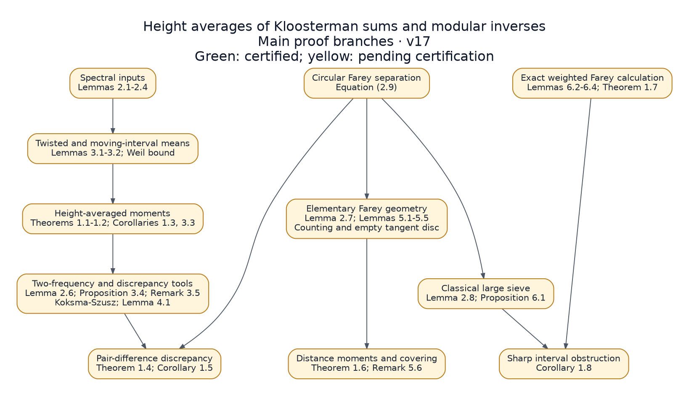

# Height averages of Kloosterman sums and modular inverses

**Debmalya Basak, Sneha Chaubey, Nicolas Robles, Igor E. Shparlinski, and Alexandru Zaharescu**

This repository documents the statements and proof dependencies of **v17** of the paper. It contains an inventory, three dependency graphs, and the data and script used to build them. The inventory covers **31 numbered results and two numbered remarks**.

**Current stage:** documentation. Formalization has not started. The manuscript itself is not included.

## Start here

| Resource | Contents |
| --- | --- |
| [Statement inventory](INVENTORY.md) | Every numbered theorem, corollary, proposition, lemma, and remark, with its TeX label, summary, source location, and proof inputs |
| [Dependency guide](DEPENDENCIES.md) | How to read the graphs, the main proof branches, and the distinction between mathematical inputs, proof-method reuse, and contextual references |
| [Overview graph](docs/dependency_overview.pdf) | The main branches on one page |
| [Numbered-statement graph](docs/dependency_graph.png) | All 33 numbered entries and seven groups of trusted reference inputs, with supporting calculations suppressed |
| [Complete documented graph](docs/dependency_complete.pdf) | Numbered statements, 46 supporting steps, and 13 precise literature inputs |
| [Machine-readable inventory](docs/dependency_inventory.json) | Stable identifiers, source locators, and an explanation for each recorded dependency |

## Proof overview

[](docs/dependency_overview.pdf)

Open the [PDF](docs/dependency_overview.pdf) or [SVG](docs/dependency_overview.svg) to enlarge the figure. Arrows point from prerequisites to consequences. The overview groups related statements; the [full guide](DEPENDENCIES.md) explains the finer distinctions.

## Mathematical scope

Let $S(m,n;c)$ be the classical Kloosterman sum and write

$$
A_X(m,n)=\sum_{c\le X}S(m,n;c).
$$

The associated modular-inverse point set is

$$
\mathcal P_X=\left\{(a/c,b/c)\in\mathbb T^2:
ab\equiv1\pmod c,\ 1\le a,b\le c\le X\right\},
\qquad N_X=\sum_{c\le X}\varphi(c).
$$

The paper studies height averages of the Fourier coefficients $A_X(m,n)$ and geometric statistics of this point set. Its main results fall into four groups.

| Results | Content |
| --- | --- |
| [Theorems 1.1-1.2 and Corollary 1.3](INVENTORY.md#thm-height) | An unconditional second-moment bound averaged over the height, uniform in the frequency range and including both signs; a further saving for moving intervals of moduli; and control outside a small exceptional set of heights |
| [Theorem 1.4 and Corollary 1.5](INVENTORY.md#thm-pair-height) | Rectangular discrepancy of pair differences, including the version with distinct pairs, with height-averaged exponent $2$ and a matching pointwise lower exponent |
| [Theorem 1.6 and Remark 5.6](INVENTORY.md#thm-distance) | The orders of positive and negative distance moments, the critical logarithmic factor, and two-sided covering-radius bounds, obtained by elementary arguments |
| [Theorem 1.7 and Corollary 1.8](INVENTORY.md#thm-correction) | An exact weighted Farey-pair correction and its positive asymptotic, followed by an interval on which the large-sieve remainder has order $Q^4$ |

For example, [Theorem 1.1](INVENTORY.md#thm-height) gives, for real $N,X\ge1$ and every $\varepsilon>0$,

$$
\int_X^{2X}\sum_{N\le\lvert n\rvert<2N}
\lvert A_Y(n,1)\rvert^2\,\frac{dY}{Y}
\ll_\varepsilon (NX)^\varepsilon NX^2.
$$

If $d_X(u)$ is the distance from $u\in\mathbb T^2$ to $\mathcal P_X$ in the flat torus metric, [Theorem 1.6](INVENTORY.md#thm-distance) gives, for $X\ge2$,

$$
\int_{\mathbb T^2}d_X(u)^s\,du\asymp_s
\begin{cases}
X^{-s},&0<s<2,\\
X^{-2}(\log X)^2,&s=2,\\
X^{-1-s/2},&s>2.
\end{cases}
$$

Here $du$ is normalized area measure. The distance proof is independent of the spectral height estimates. Likewise, the exact weighted Farey calculation is independent of the classical large sieve; the two arguments meet in the proof of the sharp interval obstruction. These separations are retained in the dependency record.

## Inventory and graph conventions

The numbered inventory contains **5 theorems, 4 corollaries, 20 lemmas, 2 propositions, and 2 remarks**. Introductory statements are counted once, rather than again at the location of their proofs. Section 7's discussion and its fixed-second-argument extension are listed separately.

The complete documented graph has **92 nodes and 112 edges**. Its supporting nodes identify calculations already present in v17. The literature nodes identify particular cited results, with locators, rather than treating the bibliography as a list of assumptions. Ordinary arithmetic and analysis are described where used without expanding them into an axiomatic dependency graph.

**Literature convention:** cited literature results are treated as trusted inputs and are not reproved here. Their precise statements, hypotheses, parameter ranges, and normalizations must match each application. The [numbered-statement graph](docs/dependency_graph.png) shows these inputs in a separate reference row, following the model repository. [PDF](docs/dependency_graph.pdf) and [SVG](docs/dependency_graph.svg) versions are available for enlargement.

The inventory distinguishes statements proved in the manuscript from cited inputs. These descriptions report the structure of the paper; they are not proof-assistant certification. There are currently no Lean files, theorem exports, or formal build targets.

## Source baseline

All statement numbers and source locations refer to the following author-held file:

| Field | Value |
| --- | --- |
| Version | v17 |
| Source filename | `second_moment_int_v17.tex` |
| SHA-256 | `a13de91bb0a5d8c1c3b0ef8ec0054932b48eea5878202ae4414bd7f4e8315a1f` |
| Documentation baseline date | 2026-11-25 |

The source fingerprint identifies the version being described. The repository contains summaries and locators, not the manuscript source or its PDF.

## Regenerate the documentation

The editable record is [`docs/dependency_inventory.json`](docs/dependency_inventory.json). Python 3 validates it and generates the inventory and DOT files; Graphviz's `dot` renders the SVG, PDF, and PNG figures.

```bash
# Validate the record without writing files or requiring Graphviz.
python3 scripts/build_dependency_graph.py --check

# Regenerate INVENTORY.md and all graph files; requires Graphviz.
python3 scripts/build_dependency_graph.py
```

When the manuscript changes, update the source fingerprint, affected entries, and dependency reasons together. Regenerate the files and review the resulting diff. The source manuscript is not needed to render the existing record.

## Repository model

The organization follows [quaternary-quadratic-forms](https://github.com/nicolasrobles/quaternary-quadratic-forms), as inspected at [commit b0465ef](https://github.com/nicolasrobles/quaternary-quadratic-forms/tree/b0465efa32fae600039f120094d10f7e533f8cd3): README, statement inventory, dependency guide, and generated graph views. The mathematical inventory and status here are specific to this paper.
